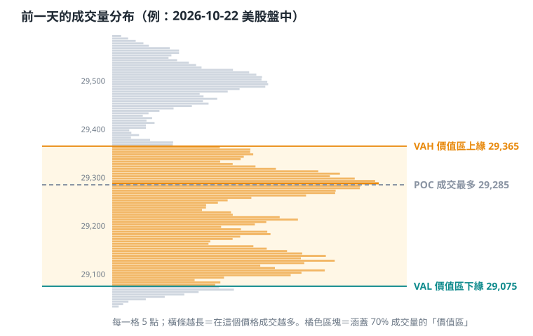
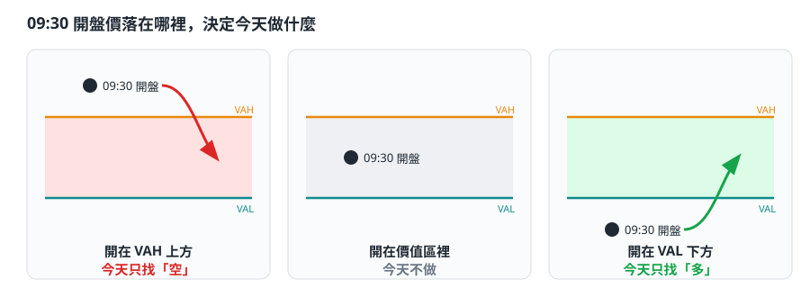
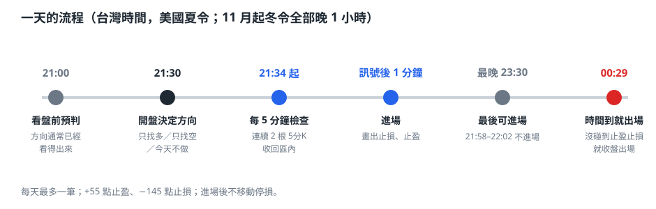
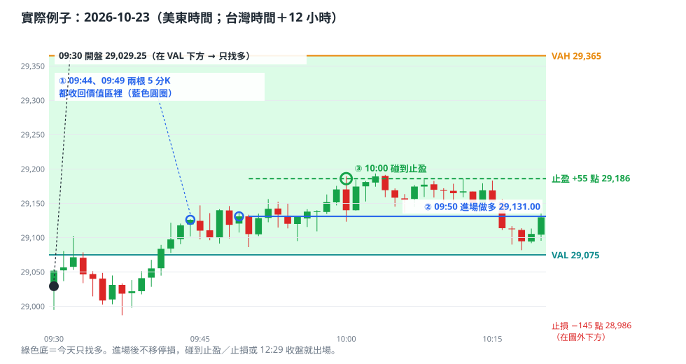
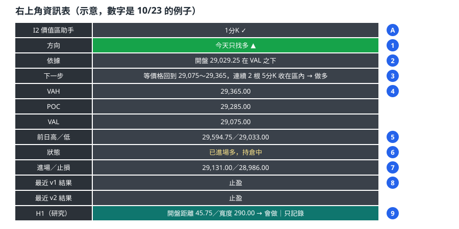
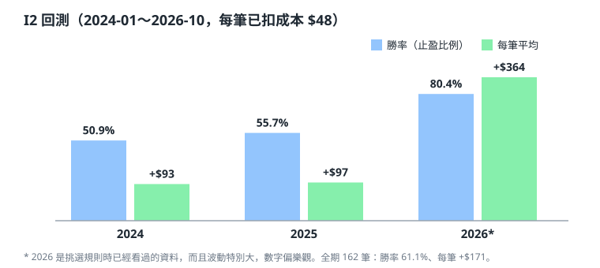

# NQ I2 價值區助手

> 一個 TradingView 指標：每天開盤前畫出「昨天市場認同的價格範圍」，開盤時告訴你今天**只找多、只找空、還是不做**，並在條件成立時發出警報。
>
> ⚠️ **研究用途，不是投資建議。** 指標只會畫線、發警報，**不會下單**。期貨有高度風險，任何交易決定請自己負責。

---

## 名詞小辭典（先看這個）
| 名詞 | 白話 |
|---|---|
| **NQ** | 那斯達克 100 指數期貨，1 點＝$20 |
| **價值區** | 前一天大部分成交（70%）集中的價格範圍，代表市場「認同」的價格 |
| **VAH／VAL** | 價值區的上緣／下緣 |
| **POC** | 前一天成交最多的價格 |
| **I2** | 這套規則的代號：開盤偏離價值區後，等價格回到區內再進場 |
| **5 分K 收在區內** | 每 5 分鐘那根 K 棒結束時的價格，落在 VAL 和 VAH 之間 |
| **v1** | 正式在測的原始規則：止盈 +55 點、最晚 11:30（美東）進場 |
| **v2** | 實驗版：只在 11:00 前進場、止盈改 +80 點，只拿來和 v1 比較 |
| **H1** | 研究中的過濾條件：開盤離價值區太遠就跳過（只顯示，不影響訊號） |
| **低把握傾向** | 不交易的日子，用開盤在 POC 上下給一個「偏多／偏空」參考，**不是交易訊號** |
| **盤前預判** | 開盤前用現價猜今天的方向，附歷史準確率；正式方向要等開盤 |
| **止盈／止損／時間到** | 先碰到 +55 點／先碰到 −145 點／到 12:29（美東）都沒碰到就收盤出場 |

## 目錄
1. [一分鐘看懂](#一分鐘看懂)
2. [什麼是「價值區」](#什麼是價值區)
3. [開盤價決定今天做什麼](#開盤價決定今天做什麼)
4. [一天怎麼用](#一天怎麼用)
5. [一個真實例子](#一個真實例子)
6. [右上角資訊表怎麼看](#右上角資訊表怎麼看)
7. [圖上的線和顏色](#圖上的線和顏色)
8. [回測結果（誠實版）](#回測結果誠實版)
9. [這個專案做了哪些研究](#這個專案做了哪些研究)
10. [安裝](#安裝)
11. [常見問題](#常見問題)

---

## 一分鐘看懂

這個指標幫你執行一條固定的日內交易規則（我們叫它 **I2**），商品是 **NQ（那斯達克 100 期貨）**：

| 步驟 | 指標幫你做的事 |
|---|---|
| 1. 開盤前 | 用**昨天**的成交量，算出昨天市場最認同的價格範圍（價值區），畫成兩條線 |
| 2. 美股開盤那一刻 | 看開盤價在這個範圍的上面、裡面還是下面，決定今天**只找空／不做／只找多** |
| 3. 開盤後 | 等價格「回到」範圍裡並站穩，跳出進場訊號 |
| 4. 進場後 | 畫出止盈（+55 點）、止損（−145 點），12:29（美東）還沒結束就出場 |

背後的想法很簡單：**價格偏離大家認同的範圍之後，常常會被拉回來。**

---

## 什麼是「價值區」

- 把**前一天美股盤中**（美東 09:30–15:59）每一分鐘的成交量，分配到它成交過的價格上（每 5 點一格）。
- **POC**：成交最多的價格，代表市場最認同的價位。
- **價值區**：從 POC 往上下擴張，直到包住全天 **70%** 的成交量。上緣叫 **VAH**，下緣叫 **VAL**。
- 價值區每天收盤後重算一次，**當天固定不動**，所以線看起來是平的。這是正常的。

---

## 開盤價決定今天做什麼

只看一個數字：**美東 09:30 開盤那一刻的第一個價格**。

| 開盤價 | 今天 | 為什麼 |
|---|---|---|
| 高於 VAH | **只找空** | 開盤就偏離到上面，賭它會被拉回價值區 |
| VAL ≤ 開盤價 ≤ VAH | **不做** | 一開盤就在大家認同的範圍裡，沒有偏離可以賭 |
| 低於 VAL | **只找多** | 開盤就偏離到下面，賭它會被拉回價值區 |

> **重點：方向一天只決定一次。** 開盤後價格就算再衝出價值區，也不會改變當天的判斷。

---

## 一天怎麼用

台灣時間（美國夏令；11 月美國改冬令後，全部晚 1 小時）：

1. **21:00 左右：看盤前預判。** 表格最上面會寫「盤前預判：偏多／偏空／在區內」。歷史上美東 09:00 時的位置，到開盤時仍在同一邊的機率是：偏多 97%、偏空 90%、在區內 86%。這只是讓你先準備，**正式決定要等開盤**。
2. **21:30 開盤：確定方向。** 表格會變成「今天只找多／只找空／今天不做」，K 線上也會出現一個大標籤。
3. **21:34 起：等進場條件。** 每 5 分鐘檢查一次：**連續 2 根 5 分 K 的收盤價都在價值區裡**，下一分鐘開盤就進場。
4. **進場後：** 止盈 +55 點、止損 −145 點，**不移動停損**。
5. **限制：**
   - 21:58–22:02 這段時間不進場，因為常有經濟數據公布。
   - 最晚 23:30 進場。
   - 00:29 還沒碰到止盈或止損，就收盤出場。
   - 每天最多一筆。

---

## 一個真實例子

2026-10-23（美東時間）：
- 價值區是 29,075～29,365。**開盤 29,029.25，在 VAL 下方，所以今天只找多。**
- ① 09:44、09:49 兩根 5 分 K 都收回價值區裡，條件成立。
- ② 09:50 在 29,131 做多，止盈設在 29,186（+55 點），止損設在 28,986（−145 點）。
- ③ 10:00 碰到止盈，扣成本後 +$1,052（NQ 1 口，每點 $20）。

---

## 資訊表怎麼看

預設是**精簡模式**（右下角，只有 3 行）：

| 列 | 意思 |
|---|---|
| 今天 | 只找多／只找空／不做（開盤前顯示「盤前看：可能…」） |
| 價值區 | VAL ～ VAH |
| 下一步 | 現在要等什麼；持倉中會顯示進場、止損、止盈；不交易的日子會附上低把握傾向 |

在指標設定的「資訊表」可以改成**完整**（下面這張圖）或**關閉**，「資訊表位置」可以選右下、右上、左下、左上。

### 完整模式

| 編號 | 欄位 | 意思 |
|:---:|---|---|
| A | 標題列 | 右邊顯示「15 分K 圖 ✓（內部用 1 分K 計算）」這類文字。如果顯示紅字，請把圖表改成 15 分 K 以下 |
| 1 | **方向** | 開盤前顯示「盤前預判」，開盤後顯示「今天只找多／只找空／不做」；綠色代表多，紅色代表空，灰色代表不做 |
| 2 | 依據 | 開盤價（或現價）在價值區的哪一邊；盤前會附上歷史準確率 |
| 3 | **下一步** | 現在要等什麼才進場 |
| 4 | VAH／POC／VAL | 今天要用的價值區 |
| 5 | 前日高／低 | 前一天美股盤中的最高和最低價 |
| 6 | 狀態 | 等待開盤 → 訊號成立 → 已進場 → 已結束 → 等待下一個交易日開盤 |
| 7 | 進場／止損 | 這筆交易的進場價和止損價 |
| 8 | 結果：規則（+55）／實驗版（+80） | 最近一筆是止盈、止損，還是時間到出場；v1 是原始規則，v2 是實驗版 |
| 9 | H1（研究） | 研究中的過濾條件，**只顯示、不影響訊號**（見下方說明） |
| 10 | 低把握傾向 | **只在「今天不做 I2」的日子顯示**：開盤在 POC 上方顯示偏多、下方顯示偏空。歷史上偏多那邊 116 筆、每筆 +$133，偏空那邊每筆 −$134；三年不一致，**把握低，不是交易訊號** |

**查看過去某一天：** 在圖上指標名稱上連點兩下，打開設定，到「歷史」勾選「查看過去某一天」並選日期，表格就會換成那一天的內容。看完取消勾選，就回到即時模式。圖表也要往回捲到那一天，K 線才會載入。

---

## 圖上的線和顏色

| 圖上 | 意思 |
|---|---|
| 橘色粗線 | VAH，價值區上緣 |
| 青色粗線 | VAL，價值區下緣 |
| 灰色細線 | POC |
| 紅色點線／綠色點線 | 前一日盤中最高／最低 |
| 兩條粗線之間的底色 | 綠色＝只找多，紅色＝只找空，灰色＝不做（開盤前是「預判」的顏色） |
| 大標籤 | 09:30 那根 K 棒標示「今天只找多 ▲／只找空 ▼／不做」 |
| 藍線／紅線／綠線 | 進場價／止損／止盈（進場後才出現） |
| 淡藍底 | 可以進場的時段（v1 和 v2 都可以） |
| 淡紫底 | 只有 v1 可以進場的時段（11:00–11:30 美東） |
| 灰底 | 09:58–10:02 美東，不進場 |

---

## 回測結果（誠實版）

用 2024-01 到 2026-10 的 1 分 K 歷史資料，NQ 1 口，每筆扣 $48 成本：

| | 2024 | 2025 | 2026（到 10 月） | 全期 |
|---|---:|---:|---:|---:|
| 交易筆數 | 55 | 61 | 46 | 162 |
| 勝率（止盈比例） | 50.9% | 55.7% | 80.4% | 61.1% |
| 止損比例 | 5.5% | 9.8% | 13.0% | 9.3% |
| 時間到出場 | 43.6% | 34.4% | 6.5% | 29.6% |
| 每筆平均 | +$93 | +$97 | +$364 | +$171 |
| 最大回撤 | −$7,456 | −$8,224 | −$7,792 | −$8,224 |

**請一定要讀這幾點：**
- **2026 年的數字偏樂觀。** 規則是看過這段資料之後才選出來的，而且 2026 年市場波動特別大。比較保守的預期是勝率約 55–65%、每筆約 +$100。
- **勝率高不代表賺錢。** +55／−145 的結構下，一次止損要連贏約 3 次才賺得回來。就算完全隨機進場，先碰到 +55 的機率也有約 72%。
- **虧損的月份很多。** 34 個月裡有 15 個月是虧的，要用「年」來看。
- 歷史成績不代表未來。

---

## 這個專案做了哪些研究

| 做了什麼 | 結果 |
|---|---|
| 測試超過 1,000 種進場規則組合 | 只有少數幾條值得追，沒有一條通過嚴格的跨年檢查 |
| 測試 74 組常見指標（RSI、MACD、布林、VWAP、EMA…） | 2024 年找到的規律，到 2025 年還成立的：0 組 |
| 測試一個開源 TradingView 策略庫的 25 個進場訊號、48 個過濾器、9 個出場方法 | 沒有一個穩定有效 |
| 總體經濟（油價、利率、戰爭、比特幣）能不能預測當天方向 | 找不到可靠的關係，只適合拿來注意風險事件（例如 FOMC 當天） |
| 改用 15 分 K 判斷 | 勝率差不多，但每筆利潤明顯較差（+$97 對 +$171） |
| 「浮盈後把停損移到成本價」 | 勝率變高，但總利潤反而變差 |
| H1：開盤離價值區太遠就不做 | 歷史上有改善（勝率 61%→65%），但統計上還不夠確定，目前只記錄、不採用 |
| 請另一個 AI 模型扮演交易專家審查 | 找出幾個數字和說法的錯誤，已經更正 |

**目前的做法：** 規則已經凍結，不再修改。現在用新的行情資料做「紙上前進測試」，在第 40、80、160 筆時固定檢查，結論分成支持、否定、證據不足三種。這樣才能分辨優勢是真的還是運氣。

### H1 是什麼？
H1 是一個還在研究中的過濾條件：**開盤價離價值區邊界太遠（距離大於價值區寬度）的日子不做。** 想法是：跳得太遠通常代表有重大消息，市場已經重新定價，不容易回來。指標會顯示「H1：會做／跳過」，但**訊號照原規則發出**，H1 只是讓你看得到，方便累積新資料來驗證。

### 研究文件（完整內容）
| 文件 | 內容 |
|---|---|
| [01 最終結論](docs/01_最終結論.md) | 整個研究的總結：測了什麼、哪些不要用、接下來怎麼做 |
| [02 策略參考結論](docs/02_策略參考結論.md) | 凍結規則的實戰觀察：進場時間、持倉時間、滑價容錯、止盈止損比例 |
| [03 交易邏輯設計](docs/03_交易邏輯設計.md) | 最早的規則設計思路與五層架構 |
| [04 2026 總經分析](docs/04_2026總經分析.md) | 戰爭、油價、利率、AI、比特幣與 NQ 的關係，以及能不能用來交易 |
| [05 外部策略研究](docs/05_外部策略研究.md) | 測試一個開源 TradingView 策略庫的所有工具 |
| [06 I2 三個假設](docs/06_I2三個假設.md) | 讓 I2 更精準的三個想法與結果（H1 的來源） |
| [07 15 分 K 版本](docs/07_15分K版本.md) | 改用 15 分 K 的四種版本比較 |
| [08 驗收流程](docs/08_驗收流程.md)、[09 附錄](docs/09_驗收流程附錄1.md) | 前進測試怎麼判斷「支持／否定／證據不足」 |
| [10 外部審查摘要](docs/10_外部審查摘要.md) | 另一個 AI 模型扮演交易專家審查後找出的錯誤與建議 |

---

## 安裝

1. 打開 TradingView，進入下方的 **Pine 編輯器**，建立一個新的空白指標。
2. 把 [`NQ_I2_價值區助手_H1研究版.pine`](NQ_I2_價值區助手_H1研究版.pine) 的內容全部貼上，按**儲存**，再按**加到圖表**。
3. 圖表設定：
   - 商品用**單一合約**，例如 `NQZ2026`。不要用連續合約 `NQ1!`，換月時會混到別的合約。
   - 時間框架用 **1、5 或 15 分鐘**都可以。H1 研究版會在背後抓 1 分 K 資料逐分鐘計算，所以不管圖表用幾分 K，結果都和 1 分 K 一樣。
   - 建議打開**延長交易時段（ETH）**，盤前預判和 09:00 的警報才會出現。
4. 想收到警報的話：建立快訊，條件選這個指標，再選「任何 alert() 函數呼叫」。

本資料夾還有：
- [`NQ_I2_價值區助手.pine`](NQ_I2_價值區助手.pine)：基本版，沒有 H1 欄位。
- [`NQ_I2_15分K參考版.pine`](NQ_I2_15分K參考版.pine)：15 分 K 版本，只供參考，回測較差。

---

## 常見問題

**Q：線一整天都是平的，是不是壞了？**
不是。價值區用前一天的資料算，一天只算一次，所以當天是固定的。美股收盤後才會換成明天的價值區。

**Q：開盤後價格衝出價值區，為什麼還是顯示「今天不做」？**
因為方向只在 09:30 開盤那一刻決定。開在區內就代表市場一開盤就接受昨天的價值，沒有偏離可以賭。

**Q：盤前預判說偏空，結果開盤變成不做？**
盤前預判只是機率。例如 2026-10-26，09:00 時價格在 VAH 上方，但開盤前最後幾分鐘跌回區內，就變成不做。

**Q：一定要用 1 分 K 圖嗎？**
不用。H1 研究版在 1／5／15 分 K 圖上都能用，它會在背後抓 1 分 K 資料計算，結果相同。我們也測過「真的用 15 分 K 來判斷」的版本（`NQ_I2_15分K參考版.pine`），每筆利潤比較差（+$97 對 +$171），所以只當參考。

**Q：免費版 TradingView 可以用嗎？**
可以，但免費方案的 CME 期貨行情會延遲約 10 分鐘，訊號也會跟著晚 10 分鐘。這條規則要在訊號後 1 分鐘內進場才有效，所以實際交易需要即時行情。另外，免費方案一張圖最多只能放 2 個指標。

**Q：換月的時候怎麼辦？**
換月當天不要用（例如 2026-12-15）。因為前一天的價值區來自另一個合約，凍結規則在換月當天本來就不做。換月後記得把商品改成新的合約，例如 `NQH2027`。

**Q：可以直接拿來實盤交易嗎？**
這是研究工具，**不是投資建議**。規則還在前進測試中，統計上還沒證明有效。

---

*本專案只包含指標程式與說明，不包含任何帳戶、下單或個人資料。*
