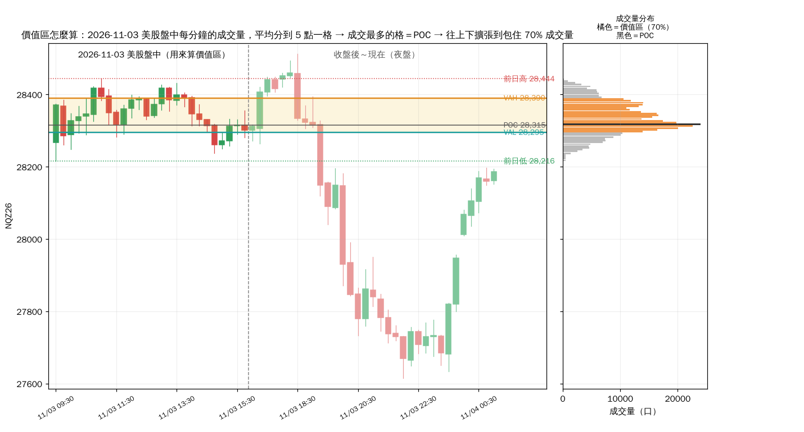

> 研究用途，不是投資建議。

# 價值區怎麼看（2026-11-04）

## 一、價值區是怎麼算出來的
指標用**前一個交易日美股盤中**（美東 09:30–15:59）的 1 分K：

1. **分格**：價格每 5 點一格（例如 28,295～28,300 是一格）。
2. **分配成交量**：每一根 1 分K 的成交量，平均分到它最高價到最低價之間的每一格。例如一根 K 棒從 28,300 到 28,320，成交 1,000 口，就分到 4 格，每格 250 口。
3. **POC**：整天加總後，成交量最多的那一格，代表市場最認同的價格。
4. **擴張到 70%**：從 POC 開始，每次比較上面一格和下面一格，把成交量大的那一格加進來（一樣大時先加下面），直到包住全天 70% 的成交量。
5. 包住的範圍就是**價值區**：上緣 **VAH**、下緣 **VAL**。

上圖右邊就是 11/3 的成交量分布：黑色是 POC 28,315，橘色是價值區 28,295～28,390（只有 95 點寬）。

- 價值區一天只算一次，**收盤後的夜盤不會改變它**。上圖夜盤從 28,512 跌到 27,615 又拉回，今天的價值區仍然是 28,295～28,390。
- TradingView 內建的 Volume Profile 用不同的資料和格寬，算出來可能差幾點。

## 二、判斷重點（NQ，2024-01～2026-10-19，690 天）

### 1. 開盤在哪裡
| 開盤位置 | 比例 |
|---|---:|
| VAH 之上 | 39% |
| 價值區內 | 33% |
| VAL 之下 | 28% |

### 2. 開盤離價值區多遠（÷ 區寬）：越遠越回不來
| 開盤離區 ÷ 區寬 | 天數 | 當天碰到價值區 | 連續 2 根 5 分K 收回區內 | 收回後走到另一邊 |
|---|---:|---:|---:|---:|
| 0～0.5 倍 | 181 | **87%** | **71%** | 49% |
| 0.5～1 倍 | 129 | 60% | 47% | 49% |
| 1～2 倍 | 78 | 49% | 44% | 55% |
| 2 倍以上 | 71 | **24%** | **18%** | 62% |

這就是 H1 的根據：開盤離區超過 1 倍區寬，回到區內的機率不到一半。

### 3. 收回價值區之後：POC 比另一邊可靠
- 開在區外、後來連續 2 根 5 分K 收回區內的日子：**碰到 POC 80%**，走到價值區另一邊只有 **50%**。
- 傳統的「80% 法則」（進了價值區有 80% 會走到另一邊）**在 NQ 上不成立**。比較可靠的第一個目標是 POC。這也是 I2 止盈只設 +55 點的原因之一。

### 4. 開在價值區內：沒有方向優勢
- 94% 的日子盤中會有 5 分K 收到區外，78% 會碰到 POC，收盤還在區內的只有 29%。
- 開在區內代表市場一開盤就接受昨天的價格，I2 沒有偏離可以賭，所以不做。

### 5. 價值區的寬度：窄的價值區代表「壓縮」，隔天容易大幅移動
| 區寬（佔價格） | 區寬 | 隔天全天振幅（中位數） | 開在區外 | 開在區內時收盤還在區內 |
|---|---|---|---:|---:|
| 最窄 25%（≤ 0.37%） | 10～115 點 | 231 點＝區寬 **3.8 倍** | **74%** | 13% |
| 偏窄 | 65～175 點 | 253 點＝2.3 倍 | 74% | 18% |
| 偏寬 | 100～255 點 | 289 點＝1.8 倍 | 65% | 26% |
| 最寬 25%（≥ 0.87%） | 160～1,665 點 | 342 點＝1.2 倍 | 53% | **47%** |

區寬分位數：10% 60 點、25% 85 點、中位數 130 點、75% 200 點、90% 281 點。

### 6. 其他要一起看的
- **前日高低**：開在前日範圍外＝比較可能是趨勢日（順勢突破的條件）；範圍內＝比較可能是區間日（I2 比較好，docs/02 第 5 節）。
- **ES 是否同向偏離**：組合 D 的 I2 要 ES 也開在 ES 自己的價值區外、同一邊（docs/11）。
- **夜盤**：夜盤不改價值區，但會決定開盤離價值區多遠。

## 三、套用到 2026-11-04
| 項目 | 數值 | 代表什麼 |
|---|---|---|
| 價值區 | 28,295～28,390（寬 95 點，0.34%） | 最窄的 25%：隔天振幅中位數是區寬的 3.8 倍、74% 開在區外 |
| POC | 28,315 | 若收回區內，第一個目標 |
| 美東 01:04 價格 | 28,186，在 VAL 下方 109 點＝區寬 1.15 倍 | 1～2 倍那組：碰到價值區 49%、收回區內 44%；H1 跳過 |
| 夜盤 | 高 28,512、低 27,615.75（振幅 897 點＝區寬 9.4 倍） | 夜盤已經遠遠走出價值區，價值區的參考性變低 |
| 前日高低 | 28,443.50／28,215.75 | 現在在前日低之下 → 若開在這裡，順勢做空的條件成立 |

## 重跑
`research/va_stats.py`（統計）、`research/va_chart.py`（畫圖）。
